# 文件权限管理

# 属主、属组、权限

# 练习

# 权限数值

## touch :默认权限644

# stat :显示文件的详细信息

# chmod
## chmod -v(verbose) :在修改时能显示权限从什么变成了什么(无论权限是否真的发生了改变都会输出详细信息)
## chmod -c(changes) :只有当权限确实被更改时才会输出信息

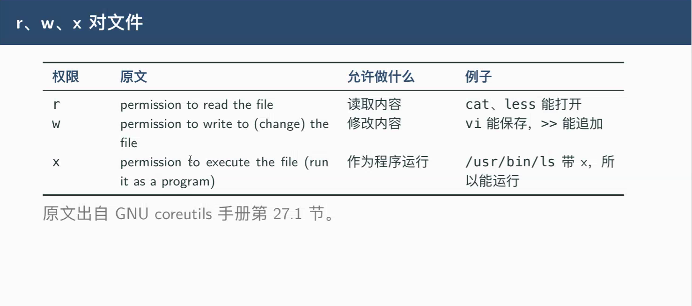

# umask :默认权限
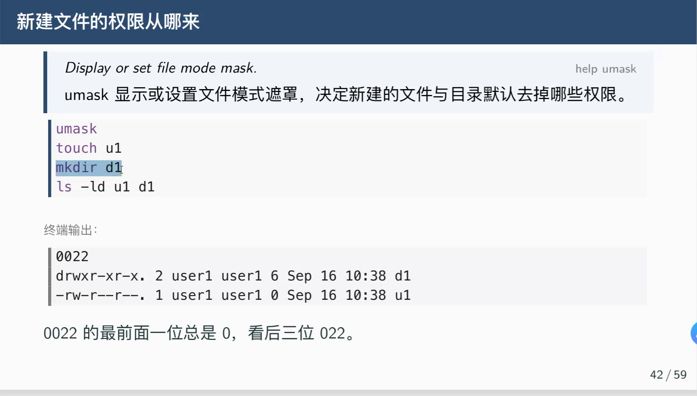
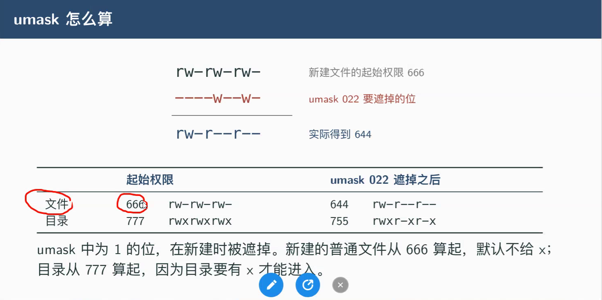
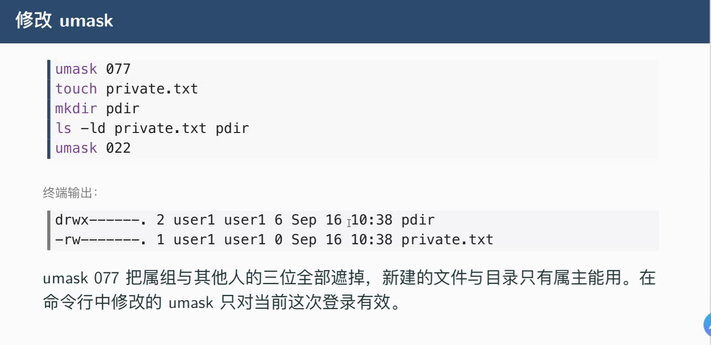

# 改属主、属组
## chown :可以修改属主,也可以修改属组
## chgrp :只能修改属组
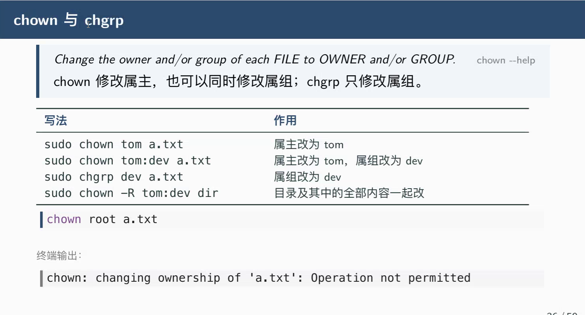

# 共享目录
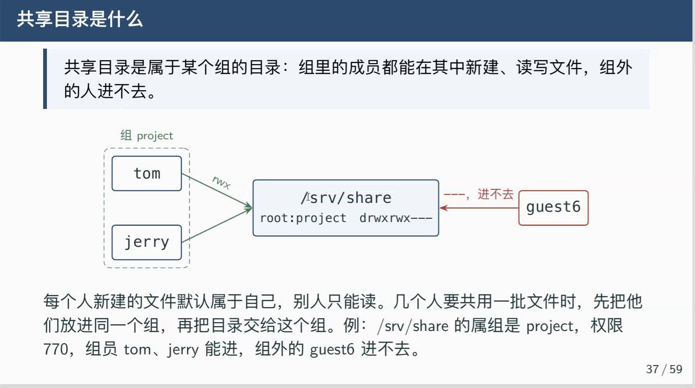
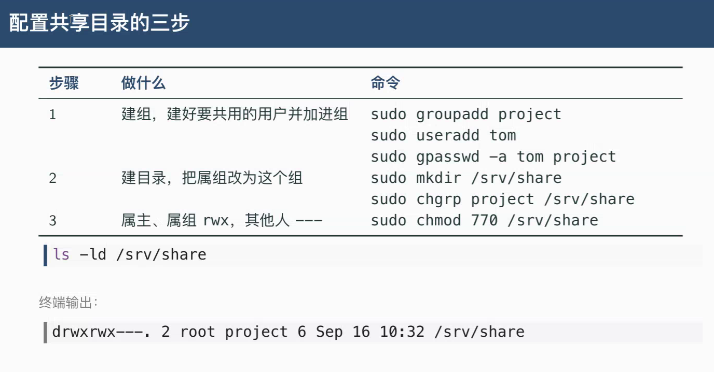

# 九位之外特殊权限
## s :special
## SUID
## SGID
## Sticky
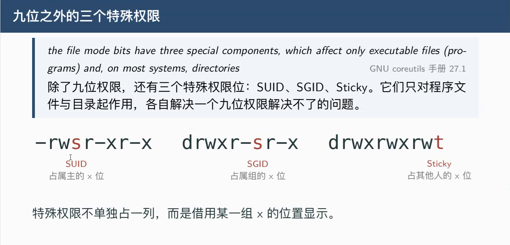
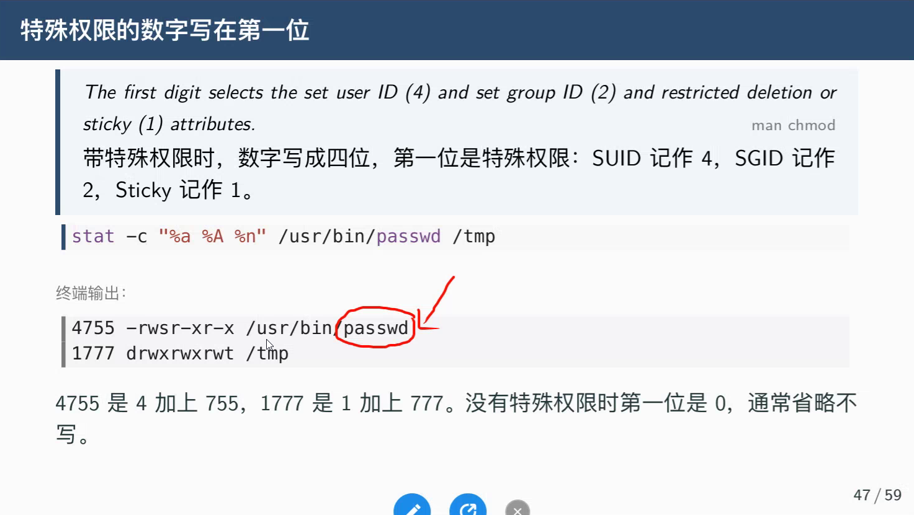
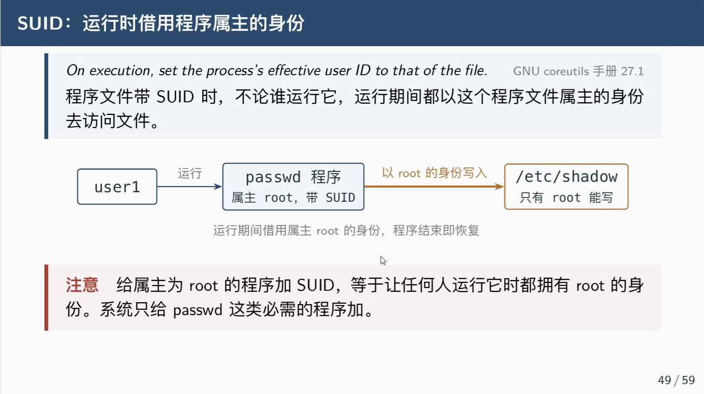
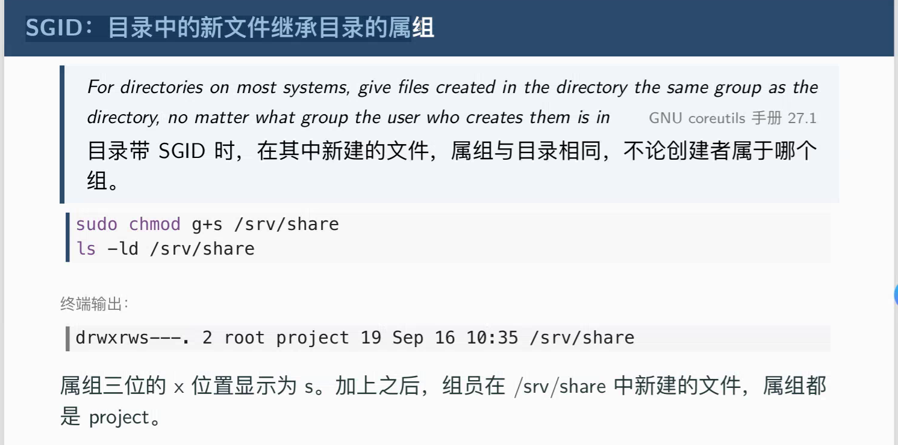
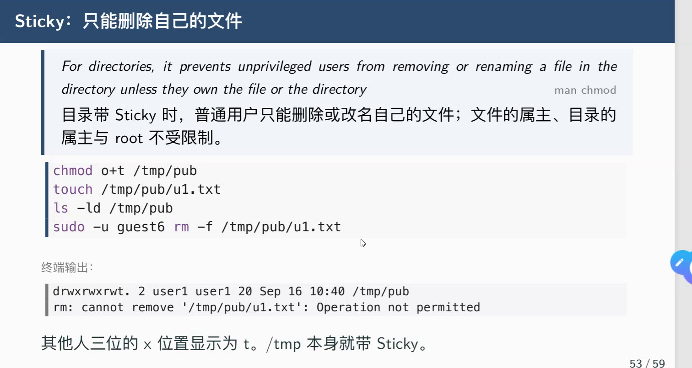
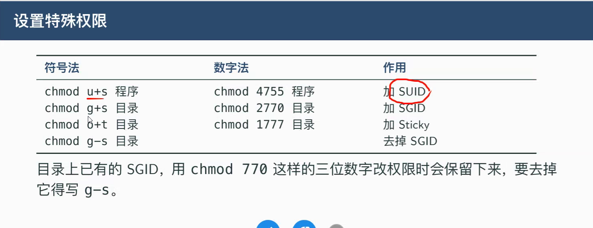

# 练习
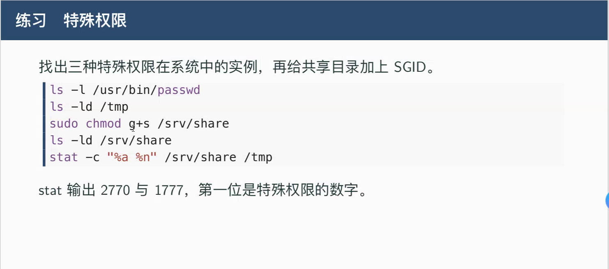