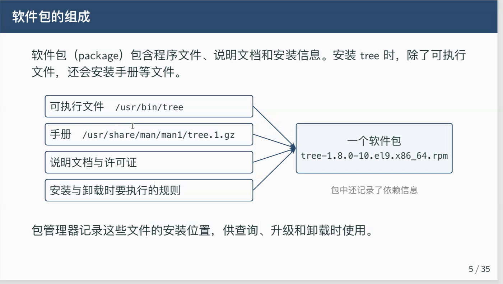
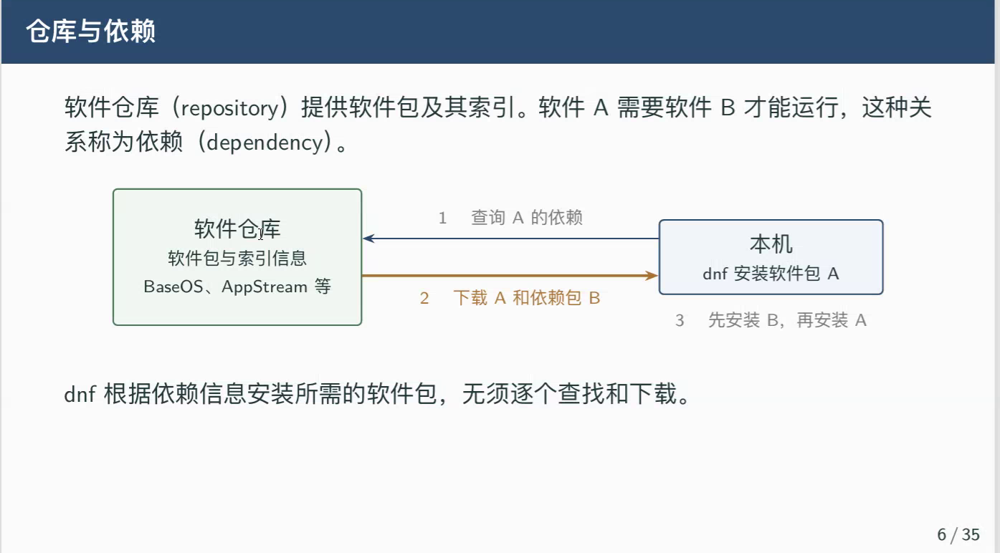
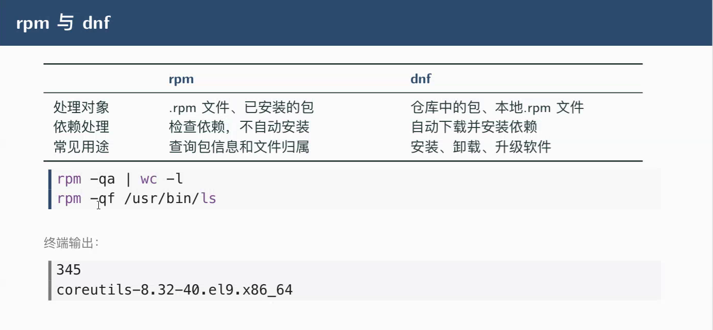

# find
## `find 文件路径 type -f/d -perm(permission,权限) -SUID` :按权限查找权限
## 如`find /usr/bin type f -perm -4000`
## 想要看得更详细 :`find /usr/bin -type f -perm -4000 -exec ls -l {} \;`

# `ls -ld 目录路径` :查看一个目录本身的权限

# 软件包管理与进程任务

# 1、软件包

# 2、仓库

## 3、rpm、dnf
