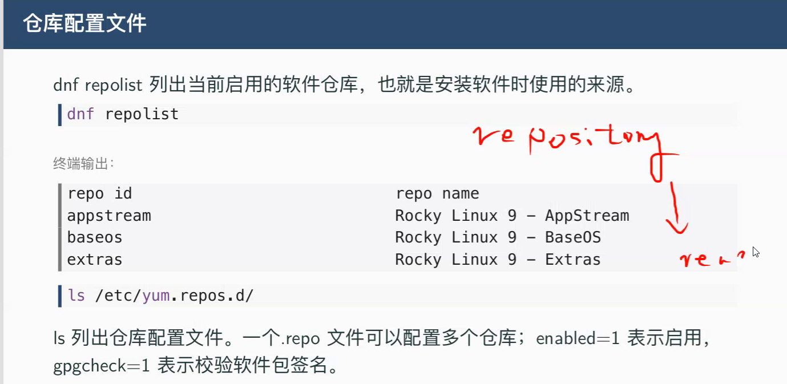
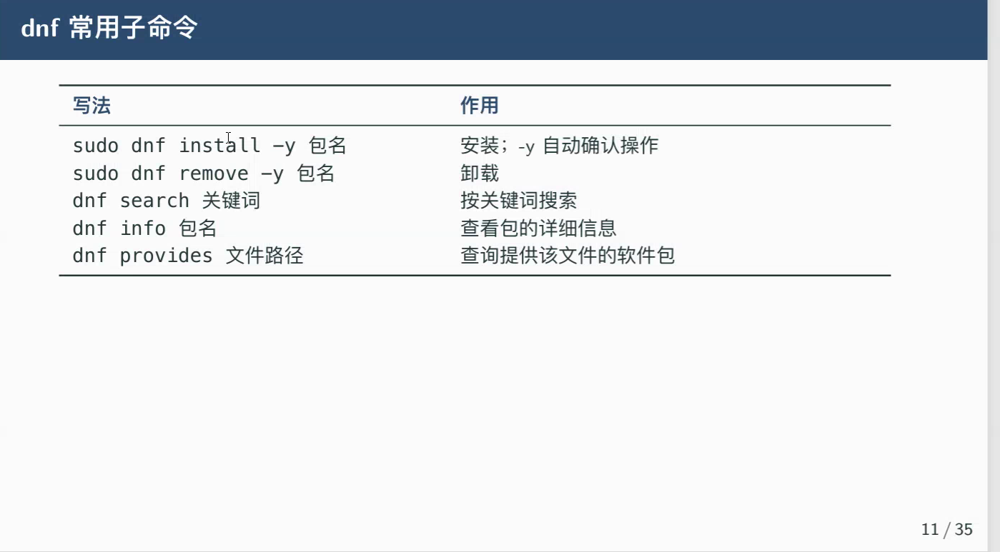
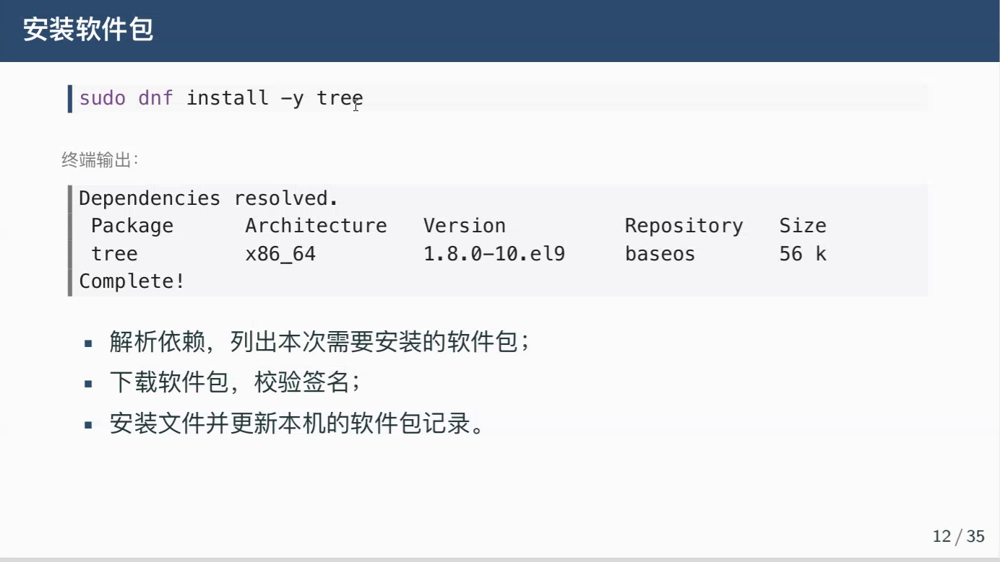
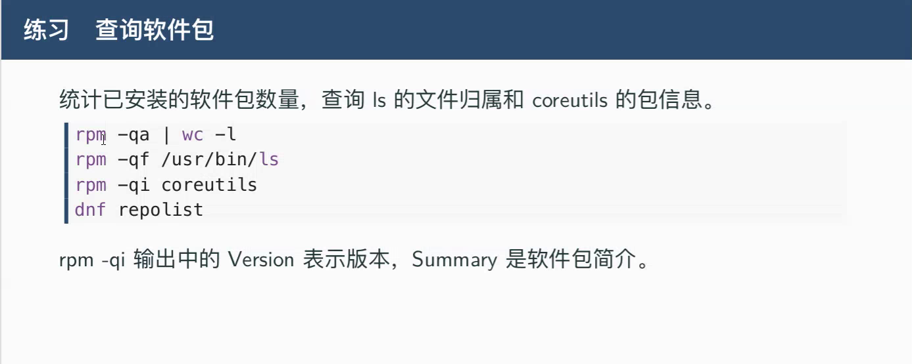

# find
## `find 文件路径 type -f/d -perm(permission,权限) -SUID` :按权限查找权限
## 如`find /usr/bin type f -perm -4000`
## 想要看得更详细 :`find /usr/bin -type f -perm -4000 -exec ls -l {} \;`

# `ls -ld 目录路径` :查看一个目录本身的权限

# Linux中,决定能否删除一个文件的,不是这个文件本身的权限,而是它所在父目录的权限;对目录有w(写)和x(执行)权限就能删除目录里的文件

# `stat -c "%a %n" 路径`
## -c :指定格式
## %a :显示八进制权限
## %n :显示文件名

# setfacl(Set File Access Control Lists) :设置文件访问控制表;允许单独赋予某人(或某组)权限且不影响其他人
## 如`setfacl -m u:student:rw /srv/design/report.txt`、`setfacl -m g:test:r /srv/design/report.txt`
## `getfacl 文件路径` :查看ACL权限
## `setfacl -x u:student report.txt` :删除特定用户的ACL
## `setfacl -b report.txt` :删除所有ACL规则

# 软件包管理与进程任务

# 1、软件包

# 2、仓库

# 3、rpm、dnf
## rpm :查看安装了的软件包
## dnf
### tree

# 练习
