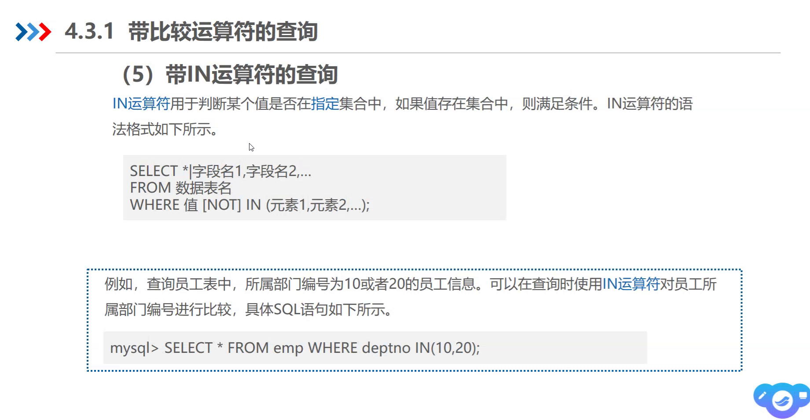
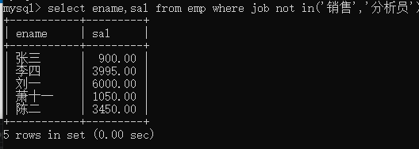
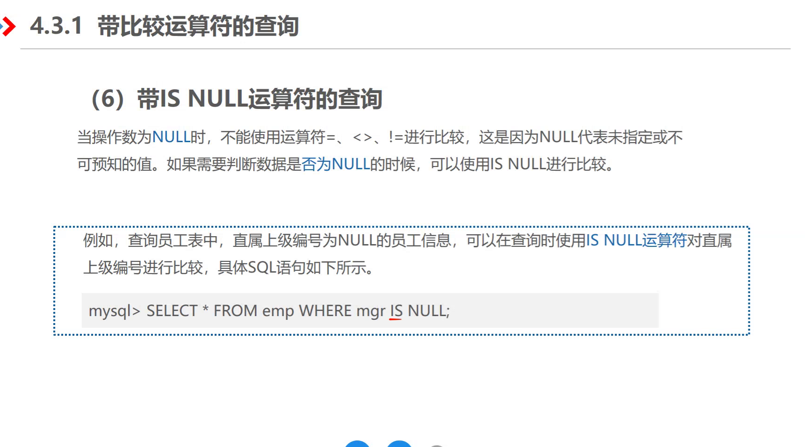
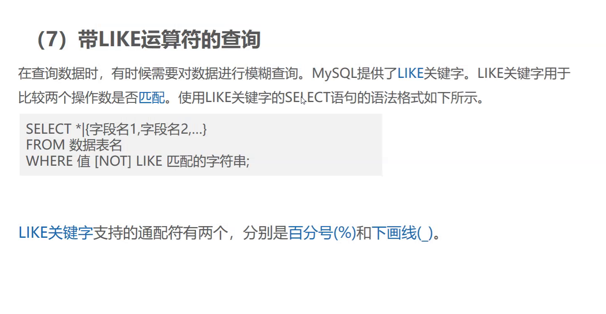
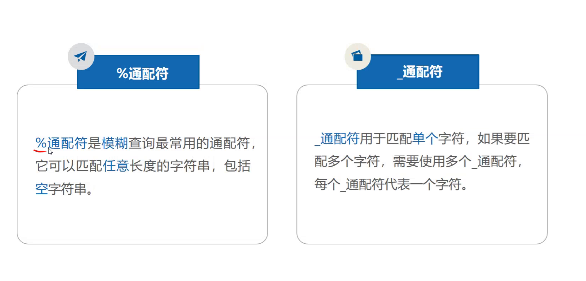
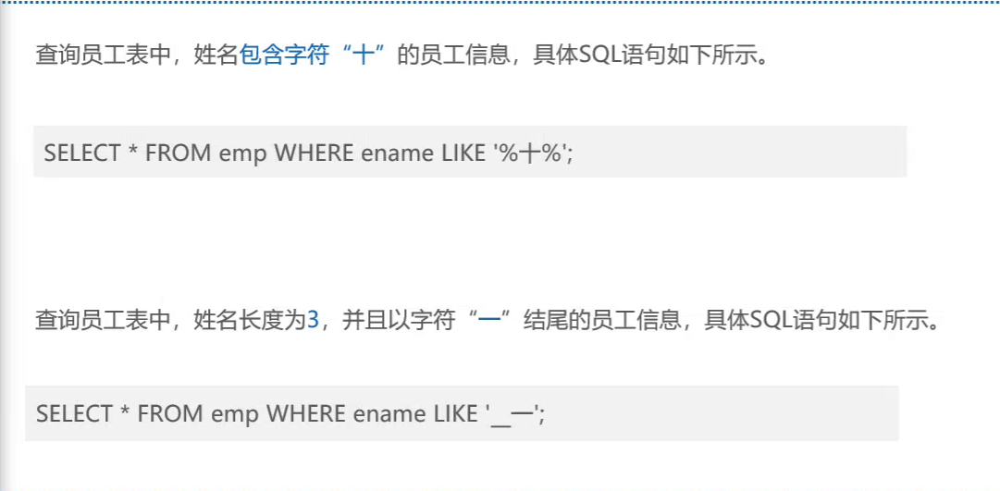
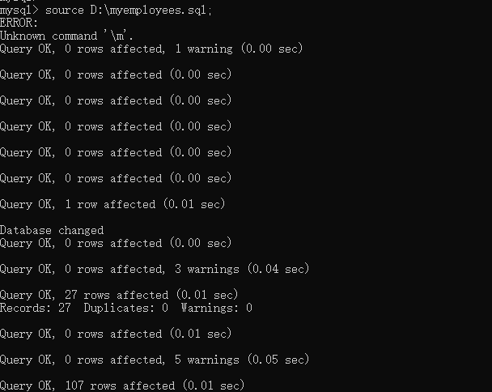

# `select * from 表名;`

# `select distinct 字段名 from 表名` :查询去重

# `select 字段名 from 表名 where ... ;`

# 带比较运算符的查询

# in
## select * from 表名 where 字段名 (not) in (10,20);
## select 字段名 from 表名 where 字段名 (not) in ('销售','其他')

# null
## `null`的查询不能用in
### select * from 表名 where 字段名 is (not) null;

# like :模糊查询

# 通配符
## %
### select * from emp where ename like '%一%';

## _
### select * from emp where ename like '_一';
### select * from emp where ename like '__一';

# 数据导入 :source 路径;
