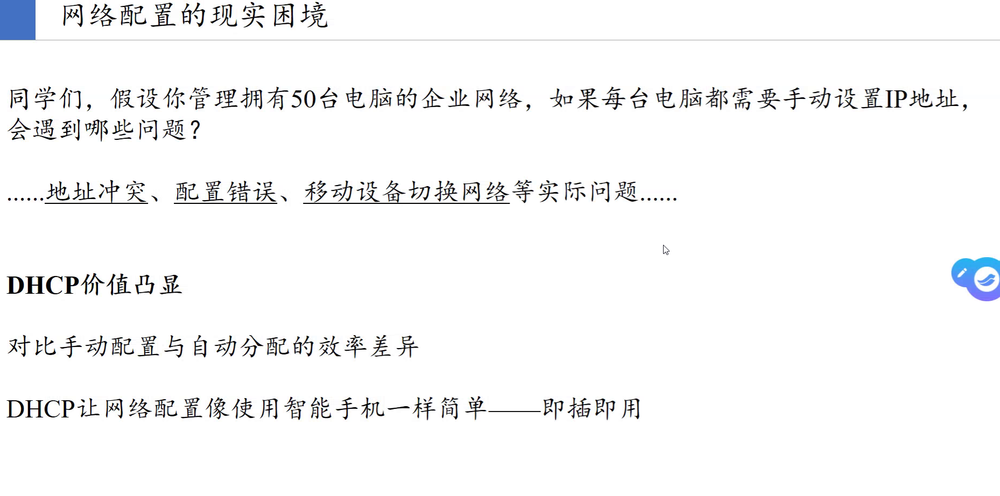
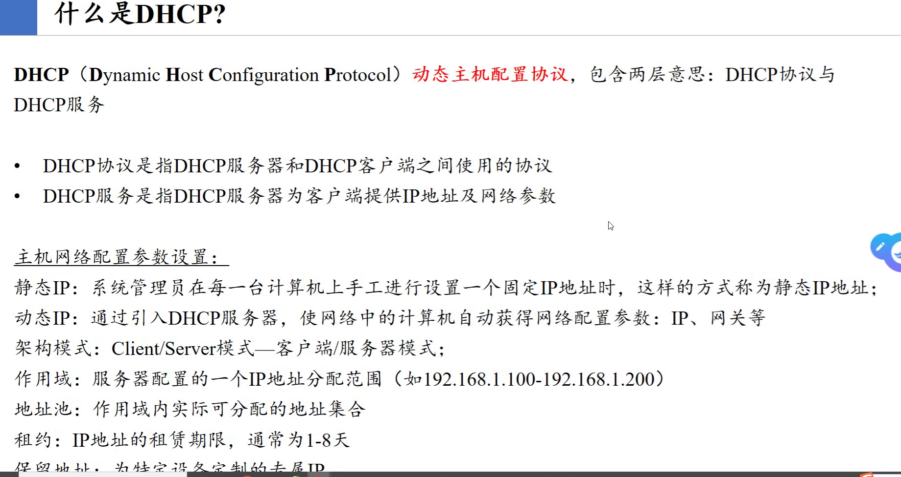
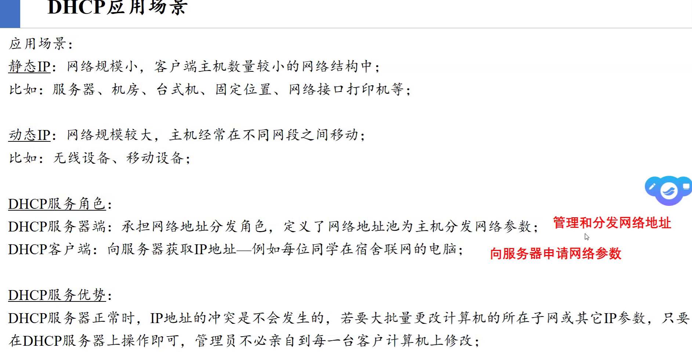
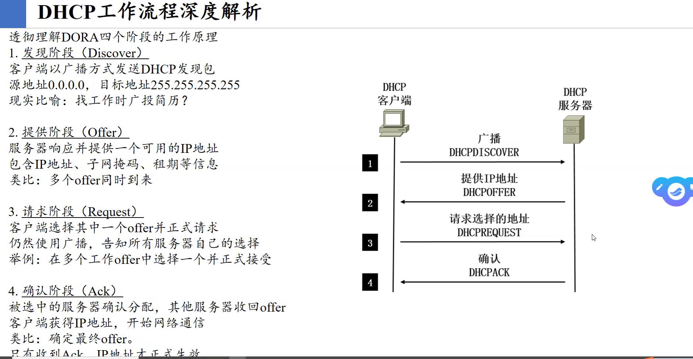
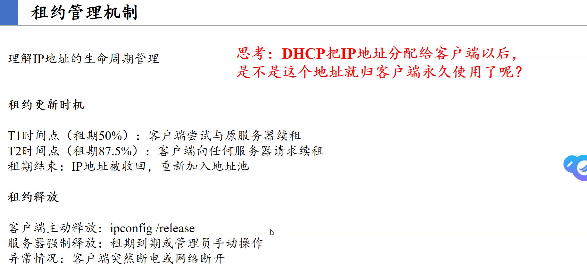
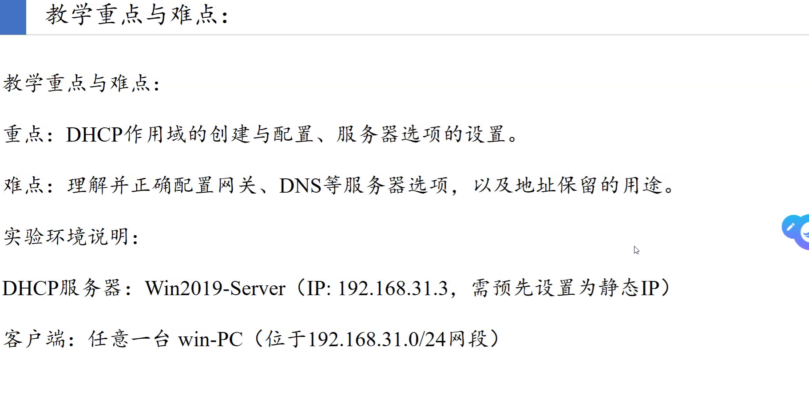
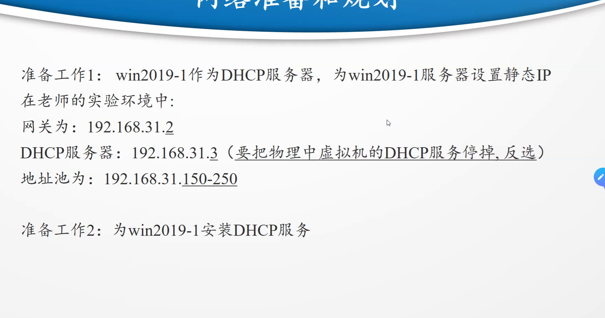
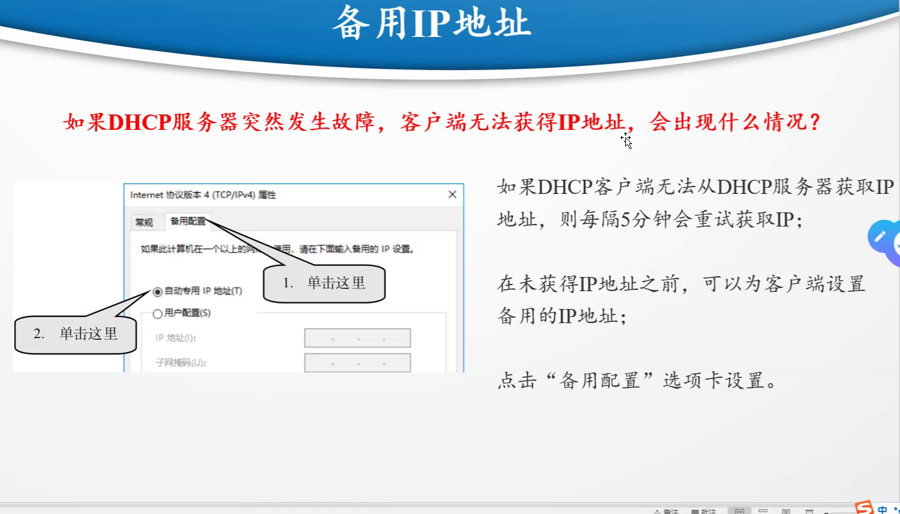
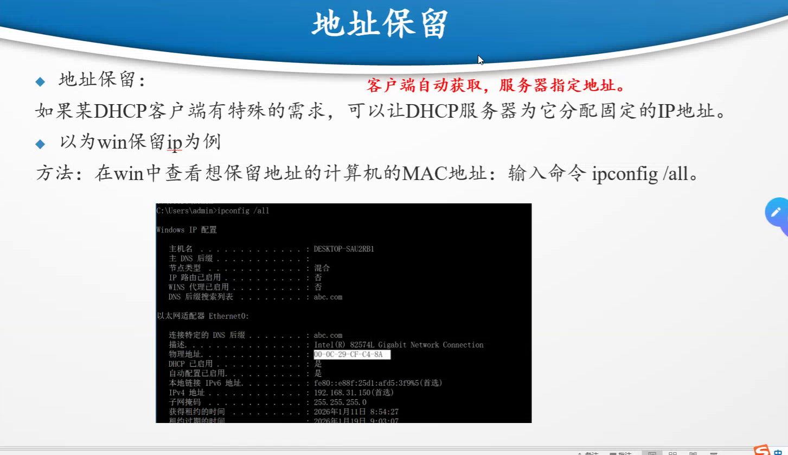
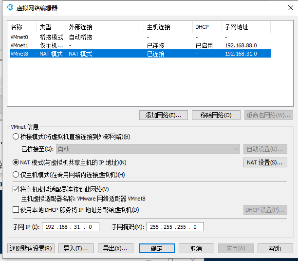

# DHCP(Dynamic Host Configuration Protocol) :动态主机配置协议

# 静态IP
# 动态IP
# 架构模式
# 作用域
# 地址池
# 租约

# ipconfig
# ipconfig -all
# ipconfig /release :释放ip地址
# opconfig /renew :重新申请ip地址

# 备用IP地址 :在客户端配置

# DHCP也可以配置固定的IP地址

# 记得将虚拟网络编辑器里面的`使用本地DHCP服务将IP地址分配给虚拟机`关掉
