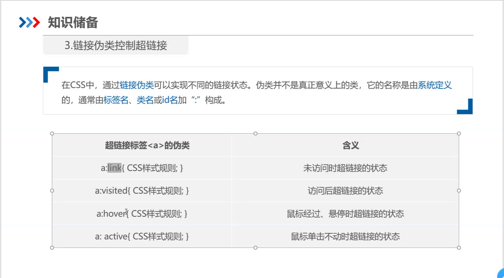
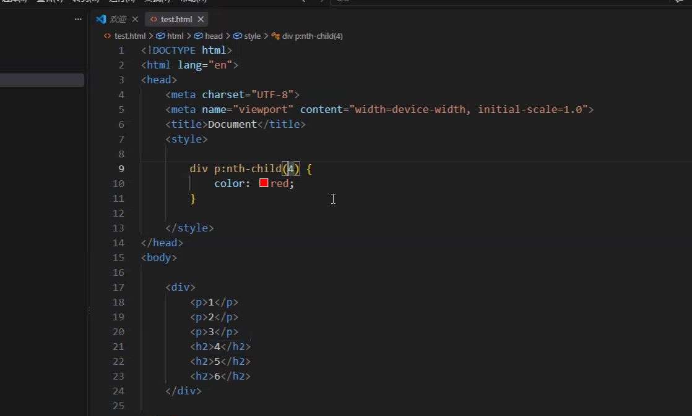
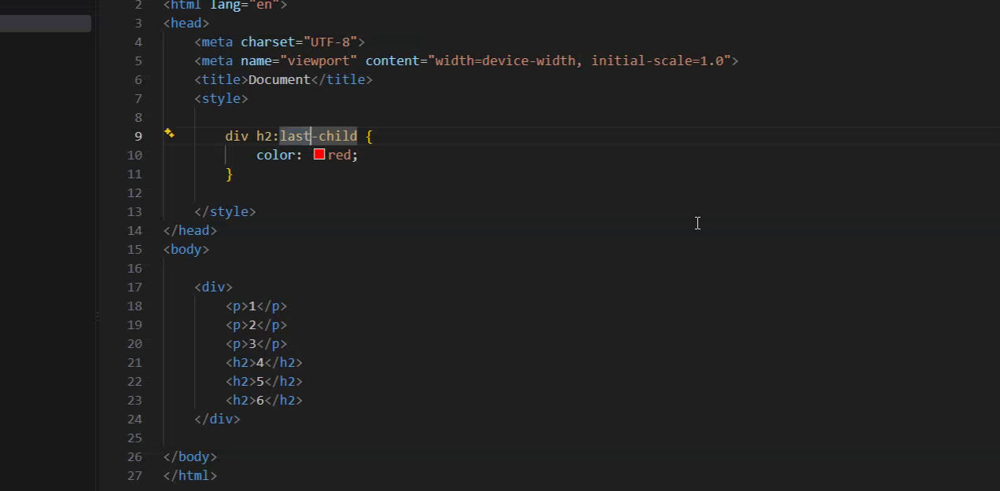
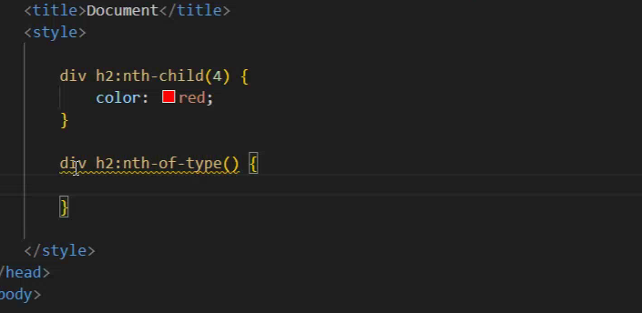

# <ul> :无序列表
# <0l> :有序列表
# <li> 
# <a href="" target="_self">
## <a>标签是行内标签
## _self是当前页面跳转
# <a href="#z1"> :锚点链接

# `list-style:none;` :去掉小圆点
# `float:left;` :将块元素<li>弄到一行里
# 行内元素里不能放块元素;块元素里可以包裹行内元素

# `a:link` :未访问时超链接的状态
# `a:visited` :访问后超链接的状态
# `a:hover` :光标悬浮时超链接的状态
# `a:active` :鼠标单击不动时超链接的状态

# `text-decoration:none;` :没有下划线

# 伪类选择器
## `first-child`
## `last-child`
## `nth-child(n)` :严格按位置数
## `nth-child(2n)`
## `nth-child(2n+1)`
## `nth-of-type(n)` :按标签类型分类数

# <table>
# <tr> :行标签
# <td> :列标签
# <th> :表头